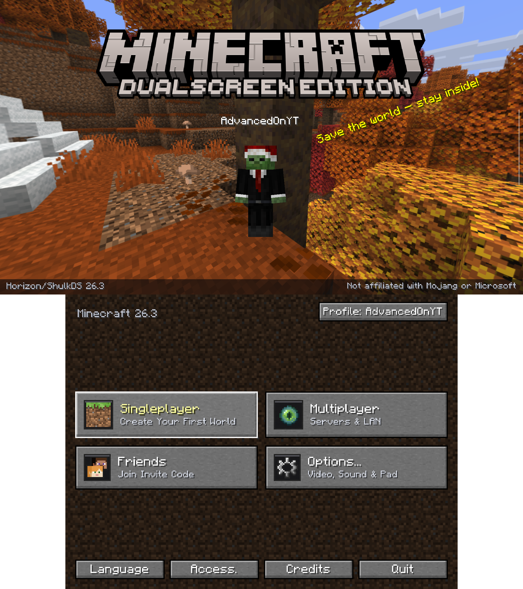

<p align="center">
  
  
  
  
  <a href="LICENSE"></a>
</p>

# ShulkDS

ShulkDS is a dual-screen Android fork of [Horizon](https://github.com/horizon-rust/horizon) and [Starling](https://github.com/starling-client/starling), a Rust rewrite of *Minecraft: Java Edition 26.3*. It is built for dual-screen Android handhelds like the **Retroid Pocket Duo** and (somewhat) **AYN Thor**, inspired by the 3DS and Wii U editions of Minecraft.

> **Disclaimer:** Not an official Minecraft product, and not approved by or associated with Mojang or Microsoft. ShulkDS does not include any Minecraft `.jar` files, assets, or game data. On first launch, sign in with a Microsoft account that owns *Minecraft: Java Edition* and the app will download and set up 26.3 on your device.

<p align="center">
  
</p>

## Highlights

- **Dual-screen gameplay:** Clean 3D view on the top screen while your map, inventory, and settings stay open on the bottom touchscreen.
- **Bottom screen dashboard:** Tabs for a live minimap with coordinates and FPS, a touch inventory with quick-manage buttons, and quick option sliders.
- **Console Edition menus:** Crafting, Creative mode, chests, workstations, and villager trading use Legacy4J Console Edition layouts built for controllers.
- **3DS-style main menu:** World panorama and rotatable 3D skin preview on top, with world and server menus on the bottom screen.
- **Handheld shortcuts:** Hold D-Pad Down to zoom, press D-Pad Left to type in chat on the bottom screen, plus reach-around placement and a radial menu.
- **Optional Distant Horizons:** Built-in LOD distant terrain support, off by default and toggleable in Options > Mods.
- **Upscaling & frame gen:** Optional FSR upscaling and 2x frame generation in quick settings for smoother performance.

## Known Issues & Planned Features

### Critical
- [ ] `Bug` Fix bottom-screen scaling and clean up UI (AYN Thor)

### High Priority
- [ ] `Feature` Customizable hotbar and HUD positioning
- [ ] `Bug` Investigate temporary 60 Hz refresh-rate lock (Retroid Pocket)
- [ ] `Optimization` Reduce heating when using Distant Horizons
- [ ] `Feature` Automatic update system
- [ ] `Feature` Built-in bug reporting with logs and GitHub integration

### Medium Priority
- [ ] `Feature` Optional classic crafting
- [ ] `Feature` Optional classic inventory
- [ ] `Feature` Fast crafting (hold craft button)
- [ ] `Compatibility` Support additional Minecraft mods
- [ ] `Feature` Built-in mod manager
- [ ] `Feature` Complete Multi-Language localization
- [ ] `Feature` Local/offline account support

### Low Priority
- [ ] `Feature` More handheld-oriented features
- [ ] `Project` Shulk dedicated server

## Install

1. Download **`shulkds-1.0.1-arm64-v8a.apk`** from [Releases](https://github.com/NaiSenshin/ShulkDS/releases/latest).
   - Updating from `v1.0.0`: install the new APK right over your current install.
   - Updating from an older `0.8.0` test build: uninstall `0.8.0` first. Your worlds and settings in `/sdcard/ShulkDS` will stay intact.
2. Open ShulkDS, allow storage access if prompted, and sign in with a Microsoft account that owns *Minecraft: Java Edition* so it can download your game files.

## Build from Source

Requires Rust 1.90+ with the `aarch64-linux-android` target, [`cargo-ndk`](https://github.com/bbqsrc/cargo-ndk), Android SDK 36, Build-Tools 35.0.0, NDK 28.2.13676358, JDK 25, and Python 3.10+.

```sh
git clone https://github.com/NaiSenshin/ShulkDS.git
cd ShulkDS
python3 packaging/android/build_apk.py --profile fast
```

The built APK outputs to `target/android/shulkds-1.0.1-arm64-v8a.apk`. No Minecraft `.jar` files, assets, or prepared resources are committed or packaged.

## License & Attribution

Built on [Horizon](https://github.com/horizon-rust/horizon) by Ludovic Marie and contributors, and [Starling](https://github.com/starling-client/starling) by JuanLuci and Vasysik, both under the MIT License, along with LGPL-3.0 code and UI assets from **Distant Horizons**, **Legacy4J**, and **Controlify**.

Original Horizon, Starling, and ShulkDS code stays MIT-licensed, while the combined project is distributed under **LGPL-3.0**. See [LICENSE](LICENSE), [LGPL-3.0](licenses/LGPL-3.0.txt), [GPL-3.0](licenses/GPL-3.0.txt), and [THIRD_PARTY_NOTICES.md](THIRD_PARTY_NOTICES.md) for full credits and license texts.
